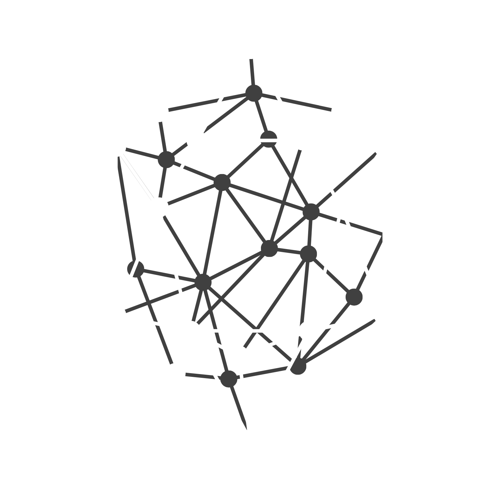

# Codite

<p align="center">
  
</p>

**Codite** is a multi-language codebase visualizer designed to transform complex source code into beautiful, interactive, and comprehensible graphs. It helps developers quickly understand project architecture, dependencies, and code structure without having to manually read through thousands of lines of code.

---

## 🌟 Key Features

*   **Multi-Language Support (Local Scanning):** Analyzes C, C++, Rust, Go, TypeScript/JavaScript, and more.
*   **Relationship Mapping:** Automatically maps dependencies between Classes, Structs, Interfaces, Functions, and Imports/Includes.
*   **Obsidian-Style Interactive Graph:** A web-based, highly interactive 2D force-directed graph UI (built with D3.js/Canvas) providing smooth zooming, hovering highlights, and dynamic filtering.
*   **High Performance:** Powered by a Rust backend utilizing [Tree-sitter](https://tree-sitter.github.io/tree-sitter/) for lightning-fast, incremental code parsing.

## 🏗️ Architecture

The system is decoupled into two main components communicating via JSON:

### 1. Analyzer CLI (Backend)
- **Language:** Rust (focusing on concurrent file processing with Rayon/Tokio).
- **Core Engine:** Tree-sitter for robust incremental parsing using `.scm` queries.
- **Output:** Generates a structured JSON file containing `nodes` and `edges`.

### 2. Visualization UI (Frontend)
- **Framework:** React / Vite.
- **Rendering Engine:** D3.js / `react-force-graph` utilizing HTML5 Canvas for performance.
- **Aesthetic:** Designed to provide an intuitive, "Obsidian-like" feel with natural physics, color-coded directories, and interactive focus modes.

## 🚀 Getting Started

To run Codite locally, follow these steps:

### Prerequisites
- [Rust](https://www.rust-lang.org/tools/install) (latest stable)
- [Node.js](https://nodejs.org/) (v18 or higher) & npm

### 1. Generate Graph Data (Analyzer)
The analyzer scans your source code and generates the visualization data.
1. Navigate to the analyzer directory: `cd analyzer`
2. Configure the target directory in `Cargo.toml` under `[package.metadata.codite]`.
3. Run the scanner: `cargo run`

### 2. Run the Visualization (UI)
1. Build the analyzer once so the bridge server can run remote scans: `cd analyzer && cargo build --release`
2. Navigate to the UI directory: `cd ui`
3. Install dependencies: `npm install`
4. Start Vite and the bridge server together: `npm run dev` (Vite proxies `/api` to the bridge on port 3002)
5. View the graph at [http://localhost:5173](http://localhost:5173), or paste a public GitHub URL into the search bar to scan it.

### Using the graph
- **Search** with `/` or `⌘K`, or pick a file in the tree. The details panel lists the node's connections (contains, imports, imported by, implements…), its source with real line numbers, and an **Open on GitHub** link for scanned repositories.
- **Focus** (`X`) shows only the selected node's neighborhood, at a depth of 1 to 3.
- **Find path** (`P`) highlights the shortest route between two nodes.
- The **legend** is a filter: click a kind or language to hide it, and Alt-click to show only that one. Selecting a folder in the tree limits the graph to that folder.
- **Export** the visible graph as PNG, SVG or JSON. Copy a shareable `?repo=owner/name` link after a scan. Recent scans are remembered.
- Light and dark themes (`T`), a minimap, and a phone layout. Press `?` for every shortcut.

### Tests
```bash
cd ui
npm test            # Vitest: utilities and components
npm run test:e2e    # Playwright: desktop + phone flows, axe accessibility checks
```
Run `npx playwright install chromium` once before the first end-to-end run.

### Bridge server settings
The `/api/scan` endpoint clones public repositories, so it is restricted by default. Override with environment variables:

| Variable | Default | Purpose |
| --- | --- | --- |
| `PORT` | `3002` | HTTP port |
| `SCAN_ALLOWED_HOSTS` | `github.com` | Comma-separated hosts that may be cloned |
| `SCAN_MAX_REPO_MB` | `200` | Reject repositories larger than this after cloning |
| `SCAN_CLONE_TIMEOUT_MS` | `60000` | Kill `git clone` after this long |
| `SCAN_ANALYZE_TIMEOUT_MS` | `120000` | Kill the analyzer after this long |
| `SCAN_MAX_CONCURRENT` | `1` | Concurrent scans; extra requests get HTTP 429 |
| `ANALYZER_BIN` | `../analyzer/target/release/analyzer` | Path to the analyzer binary |

Each scan's graph is returned in the API response, so concurrent users never overwrite each other's results.

## 🤝 Contributing

We welcome contributions! Please see our [CONTRIBUTING.md](CONTRIBUTING.md) for details on how to get started, our code of conduct, and our development process.

## 📄 License

This project is licensed under the **GNU General Public License v3.0** - see the [LICENSE](LICENSE) file for details.
